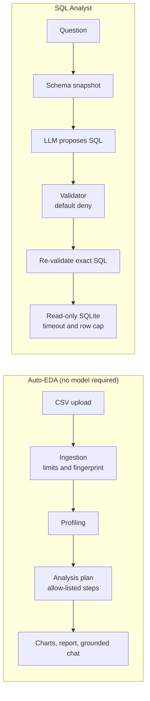

<div align="center">

# AIDA

### AI Data Analyst Agent

**Upload a CSV or ask a database a question in plain English. Every number comes from code, not from the model.**

[](https://github.com/Somaskandan931/AI_Data_Analyst/actions/workflows/ci.yml)


[](LICENSE)

[Features](#features) · [How it works](#how-it-works) · [Quick start](#quick-start) · [Safety](#safety-model) · [Evaluation](#evaluation) · [Deployment](#deployment) · [Docs](#documentation)

</div>

---

## What is AIDA?

AIDA is a data-analysis assistant with two workspaces in one [Streamlit](https://streamlit.io) app:

| | **Auto-EDA** | **SQL Analyst** |
| --- | --- | --- |
| **Input** | A CSV file | A question, plus a SQLite database |
| **What you get** | Profile, cleaning, analysis, charts, a downloadable report, grounded chat | A validated, read-only SQL query and its result |
| **Who does the work** | Deterministic Python (pandas, SciPy, scikit-learn) | An LLM proposes SQL; code validates and runs it |
| **Model access** | None required | Gemini or a local Ollama model |

Most "chat with your data" tools let a model write and run whatever it likes. AIDA takes the
opposite stance: **the model may propose, but only reviewed code decides and computes.** The
model never executes code, and every figure shown can be traced to a computed result.

## Features

**Auto-EDA**

- Validated CSV ingestion with size, row and column limits, and a fingerprint of the upload
- Deterministic profile: types, missing values, duplicates, ranges and summary statistics
- Cleaning on a working copy (drop duplicates, drop missing rows, mean or median imputation,
  row filters); your original data is never modified
- Allow-listed analysis: summary statistics, grouped aggregation, correlation (Pearson or
  Spearman), distributions, outliers (IQR rule), k-means clustering and PCA
- Charts built from computed results, plus HTML and Markdown reports with their methods
- Chat that answers from computed artifacts, shows its evidence, and refuses out-of-scope
  questions instead of guessing

**SQL Analyst**

- Natural-language question to SQL with Gemini or a local Ollama model
- Default-deny validation of the SQL syntax tree (not the raw string) against the real schema
- Read-only execution with a timeout and a row cap, and a flag when results are truncated
- Clarifying questions for ambiguous wording instead of a confident guess
- Specific, actionable messages for configuration problems (missing key, unsupported provider)

## How it works



The package is split so each layer can be tested without the UI:

```
src/ai_data_analyst/
├── ingestion/       validated CSV loading
├── profiling/       deterministic dataset profile
├── analysis/        cleaning, plans and allow-listed operations
├── visualization/   chart specifications from computed results
├── reporting/       reproducible HTML and Markdown reports
├── chat/            question routing and grounded answers
├── sql_agent/       schema, generators, validator, executor, pipeline
├── security/        limits, audit events, hashing
├── evaluation/      benchmarks, metrics, run reports
└── ui/              Streamlit pages only
```

Module boundaries are enforced by a test (`tests/unit/test_import_boundaries.py`); see
[docs/ARCHITECTURE.md](docs/ARCHITECTURE.md).

## Safety model

Uploads, questions, model output, schema comments and database content are all treated as
untrusted. Protection is layered, so no single check has to be perfect:

| Layer | What it does |
| --- | --- |
| No model-generated code | Models can only propose typed plans or SQL; nothing generated is ever `exec`'d |
| Syntax-tree validation | `sqlglot` parses the query; anything not explicitly allowed is denied |
| Schema allow-list | Unknown tables and columns are rejected before execution |
| Single `SELECT` only | Writes, DDL, `PRAGMA` and multiple statements are refused |
| Re-validation | The exact normalized SQL is validated again immediately before it runs |
| Read-only database | SQLite opened with `mode=ro` and `PRAGMA query_only = ON` |
| Resource limits | Per-query timeout, result-row cap and upload limits, all configurable |
| Secrets | API keys are never written into error messages or pages |

Details and the threat model are in [docs/SECURITY.md](docs/SECURITY.md).

## Quick start

Requires Python 3.11 or newer.

**Windows (PowerShell)**

```powershell
git clone https://github.com/Somaskandan931/AI_Data_Analyst.git
cd AI_Data_Analyst
python -m venv .venv
.\.venv\Scripts\Activate.ps1
pip install -e ".[app,dev,gemini,ollama]"
Copy-Item .env.example .env      # then edit .env
streamlit run app.py
```

**macOS / Linux**

```bash
git clone https://github.com/Somaskandan931/AI_Data_Analyst.git
cd AI_Data_Analyst
python -m venv .venv && source .venv/bin/activate
pip install -e ".[app,dev,gemini,ollama]"
cp .env.example .env             # then edit .env
streamlit run app.py
```

Auto-EDA works immediately, including a built-in sample dataset. The SQL Analyst needs an LLM
provider, configured below. Try asking the sample database things like *"What is the average
demand by region?"* or *"Which date had the highest demand_mwh?"*.

## Configuration

Settings come from the environment or a local `.env` file (never commit it). Blank values count
as unset.

| Variable | Default | Purpose |
| --- | --- | --- |
| `LLM_PROVIDER` | `gemini` | `gemini` or `ollama` (case-insensitive) |
| `LLM_MODEL` | provider default | Gemini: `gemini-2.5-flash`. Ollama: `qwen2.5-coder:7b` |
| `LLM_API_KEY` | none | Required for Gemini |
| `APP_PASSWORD` | none | If set, visitors must enter it before the app renders |
| `AIDA_MAX_UPLOAD_BYTES` | 25 MiB | Caps CSV and SQLite uploads |
| `AIDA_MAX_ROWS` / `AIDA_MAX_COLUMNS` | 250000 / 200 | Dataset shape limits |
| `AIDA_MAX_EXECUTION_SECONDS` | 30 | Analysis time budget, checked between plan steps |
| `AIDA_SQL_TIMEOUT_SECONDS` | 5 | Per-query SQL timeout |
| `AIDA_MAX_RESULT_ROWS` | 1000 | Rows returned by one SQL query |

**Using Ollama locally:** run `ollama serve`, pull `qwen2.5-coder:7b`, and set
`LLM_PROVIDER=ollama`. Ollama only works on the same machine, so hosted deployments should use
Gemini.

## Evaluation

AIDA reports only numbers backed by a recorded run. Method, limits and raw artifacts are in
[docs/EVALUATION.md](docs/EVALUATION.md).

| Benchmark | Result | Read it carefully |
| --- | --- | --- |
| Auto-EDA, fixed sample dataset (485 rows) | Every recorded metric scored 1.0: profile fields (77), analysis coverage and grounding (19 questions), out-of-scope refusals (12), execution reliability (7) | Small, fixed benchmark on a synthetic dataset; it shows correctness on known cases, not general accuracy |
| SQL, original model-driven run (Ollama, `qwen2.5-coder:7b`) | **12 / 15** | This is the honest measure of LLM-generated SQL on the benchmark |
| SQL, final regression run | 15 / 15 | Uses reference SQL for selected categories to test the **pipeline**; not LLM accuracy |
| Test suite | 1,250+ tests passing | Includes adversarial SQL, limits, grounding and UI tests |

Reproduce locally:

```bash
python scripts/run_auto_eda_eval.py --repeats 30
python scripts/run_sql_benchmark.py        # needs an LLM provider configured
```

## Deployment

AIDA runs on Streamlit Community Cloud, Hugging Face Spaces, or any container host (a
`Dockerfile` is included). Set `LLM_PROVIDER`, `LLM_API_KEY` and `APP_PASSWORD` as secrets.
Step-by-step instructions and a pre-launch checklist are in
[docs/DEPLOYMENT.md](docs/DEPLOYMENT.md).

> **Scope.** AIDA is a research and portfolio MVP for a single user or a small trusted group,
> not a hardened multi-tenant service. Put a password in front of any public deployment.

## Development

```bash
ruff check .
ruff format --check .
mypy
python -m pytest -q
```

CI runs these four commands on Python 3.11 and 3.12. To check the oldest supported dependency
versions, install with `-c constraints-min.txt`; the reasons for the less obvious floors
(`sqlglot >= 30.13`, an older `pyarrow` on NumPy 1.x) are noted in that file. See
[CONTRIBUTING.md](CONTRIBUTING.md) for the workflow.

`data/sample/electricity_demand.csv` is a synthetic, seeded dataset with planted missing values,
duplicates and outliers. Its expected profile is computed independently with the standard
library and cross-checked against pandas. Regenerate it with `python scripts/generate_fixture.py`
(the output must be byte-identical).

## Known limitations

- The SQL Analyst supports SQLite only, and one `SELECT` per question.
- `AIDA_MAX_EXECUTION_SECONDS` is checked between plan steps, so one slow step can overrun it.
- SQL pipeline audit events are not implemented yet.
- SQL accuracy beyond the 15-case benchmark has not been measured.
- Uploaded SQLite files live in the server's temp directory for the session.
- `APP_PASSWORD` is one shared password, not user accounts.

## Documentation

| Document | Contents |
| --- | --- |
| [Architecture](docs/ARCHITECTURE.md) | Modules, boundaries, shared contracts |
| [Security](docs/SECURITY.md) | Threat model and controls |
| [Evaluation](docs/EVALUATION.md) | Metrics, benchmark runs, interpretation |
| [SQL Analyst guide](docs/M2_IMPLEMENTATION.md) | Pipeline, setup and handover for the SQL agent |
| [Row filters](docs/FILTERS.md) | Filter contract for analysis steps |
| [Deployment](docs/DEPLOYMENT.md) | Hosting options and checklist |
| [Product requirements](docs/PRD.md) | Goals, scope and milestones |
| [Changelog](CHANGELOG.md) | Release notes |

## Contributing and security

Contributions are welcome; start with [CONTRIBUTING.md](CONTRIBUTING.md). Please report
vulnerabilities privately as described in [.github/SECURITY.md](.github/SECURITY.md).

## Authors

Built by Somaskandan, Nishi and Prathin.

## License

MIT. See [LICENSE](LICENSE).
